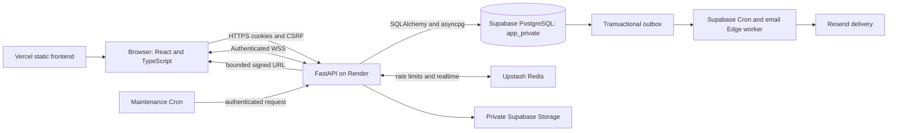

# System architecture at the audit baseline

BuddyWebv2 is a monorepo: React renders browser screens; FastAPI enforces identity and
domain rules; PostgreSQL stores durable application state. Supabase hosts PostgreSQL,
private Storage and scheduled Edge workers. It is not the application's login authority.

Source entry points: [main.tsx](../../apps/web/src/main.tsx),
[App.tsx](../../apps/web/src/App.tsx), [FastAPI main](../../apps/api/app/main.py),
[database setup](../../apps/api/app/core/database.py). Hosted relationships above are
supported by [Production records](../implementation/production-status.md), rather than
inferred from the existence of configuration files.

## Boundaries and responsibilities

| Boundary                 | Responsibility                                                  | Must not be confused with           |
| ------------------------ | --------------------------------------------------------------- | ----------------------------------- |
| React route/feature flag | UI availability and navigation                                  | Backend authorization               |
| Zustand session store    | In-memory sanitized user/session state                          | Credential persistence              |
| TanStack Query           | Server-response caching, invalidation and retry                 | Durable domain storage              |
| FastAPI dependency       | Current persisted role, session and capability checks           | Trusting a submitted user ID        |
| Domain service           | Eligibility, state transitions, locking and transaction staging | Independent public endpoint         |
| PostgreSQL               | Atomic writes, foreign keys, uniqueness and cohort isolation    | Redis realtime notifications        |
| Supabase Storage         | Private image/backup objects                                    | Public bucket/object-key exposure   |
| Email outbox             | Commit-consistent delivery intent with retries                  | Guaranteed immediate email delivery |

A DTO is a deliberately selected response shape. The safe Matching DTO carries useful
profile details and score explanations without returning an entire private user record.
An ORM maps SQL rows to Python objects; it does not remove the need for constraints or locks.

## Request and data flows

A recommendation read moves from `MatchingPage` through `use-recommendations.ts` and
`matching-client.ts`, the common credentialed HTTP client, `/api/matching/recommendations`,
backend eligibility, then deterministic scoring. It returns a bounded DTO page and does
not create a Match. A later recipient acceptance creates the relationship and conversation
inside the API transaction. See the [workflow walkthroughs](WORKFLOWS.md).

Chat stores messages in PostgreSQL before treating realtime delivery as useful acceleration.
Redis transports notifications; reconnecting clients recover through REST history. The
90-day message expiry and cleanup path are implemented independently of browser lifetime.

Events have one canonical persistence source. The Landing and User Events tab share a
localized slider query and the same first-five selection. There is no separately persisted
Slider entity or manual ordering service. Admin and public frontend controls are independent
strict build-time flags; API role checks remain active regardless of those flags.

## Current and historical architecture

September began with a frontend foundation. Backend auth, profiles, email verification,
recommendations, invitation acceptance and chat arrived in successive vertical slices.
The original static Event presentation evolved into canonical APIs, an initially shared
launch switch, then independent Admin/public switches. The October 14 Audience removal
changed public eligibility while retaining legacy database values.

Cloud Run was investigated but dropped in favor of Render Free for the initial API.
The repository does not prove a prior Cloud Run Production deployment. Paid-worker ideas
were replaced with hosted Cron/Edge delivery; the Python mail worker remains a fallback.
See [decisions](decisions/README.md) and [history](CHANGELOG.md).

## Limits

The current repository migration head is `0022_public_event_visibility_default`;
Production revision was not independently captured for that release. A failed private
Semester backup prevents claiming end-to-end operational recovery. Render Free cold starts
and capacity are documented risks, not fresh provider guarantees. The current large frontend
bundle advisory is recorded; this audit adds no performance measurement.
