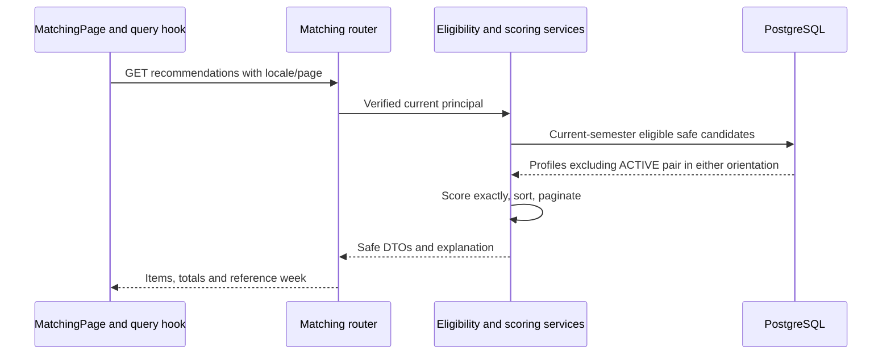

# End-to-end implementation walkthroughs

These describe baseline code. Acceptance and deployment qualifications are linked separately.
Paths are intentionally focused so a learner can follow one workflow without rereading the plan.

## 1. Registration, login and verification

**Purpose:** create a USER account, establish a browser session and verify control of the current
email before granting Buddy capabilities. [Registration page](../../apps/web/src/pages/public/user-registration-page.tsx)
and [session client](../../apps/web/src/features/auth/session-client.ts) use the
[auth router](../../apps/api/app/api/auth.py).

The browser obtains CSRF state and submits credentials. `register_user` in
[auth.py](../../apps/api/app/services/auth.py) canonicalizes a conservative ASCII email,
hashes the password and locks/selects the CURRENT semester. A missing current semester fails
registration; clients cannot submit an ADMIN role. Persisted `users`, `refresh_sessions`
and verification/outbox records have separate responsibilities. Login verifies the password,
sets cookie credentials and returns sanitized identity. Bootstrap/refresh recovers sessions
after reload; rotation and reuse detection protect refresh families.

[Verification requests](../../apps/api/app/services/email_verification_requests.py) stage a
token and outbox delivery intent. [Token consumption](../../apps/api/app/services/email_verification.py)
uses a cryptographic token digest, current-email snapshot and 15-minute deadline with one-use
consumption. Email links carry a sealed delivery value; verification updates the authoritative
current identity. Changing email requires reverification. Expired or replayed links must fail
safely; email failure does not turn an unverified user into a verified one.

History: auth arrived Sep 16–18, verification/outbox Sep 24–26, template parity Oct 17.
Evidence: [AUTH-021](../implementation/tasks/AUTH-021.md),
[verification task](../implementation/tasks/FE-VERIFY-001.md),
[latest email release](../operations/email-template-redesign-production-2026-10-17.md).
No fresh email was sent by this audit, and latest Gmail/Outlook acceptance is absent.

## 2. Profile onboarding, editing and avatars

**Purpose:** collect a usable matching profile without exposing private account data.
[Onboarding identity](../../apps/web/src/pages/user/onboarding-identity-page.tsx), interests,
preferences and [edit](../../apps/web/src/pages/user/profile-edit-page.tsx) pages call
[profile APIs](../../apps/api/app/api/profile.py) and [profile service](../../apps/api/app/services/profiles.py).
The server derives ownership from the session and returns the current version; updates use
optimistic version checking. A stale editor receives a conflict instead of overwriting newer data.

`student_profiles` belongs to `users`; catalog join tables and custom preferences store
interests, activities and languages. Availability stores timezone-aware weekly slots.
[Completion](../../apps/api/app/services/profile_completion.py) distinguishes being signed in
from being complete/eligible. Matching opt-in and verified identity remain separate controls.
Once an ACTIVE Match exists, changing `student_type` is blocked by the server to preserve
the opposite-type relationship invariant.

[Avatar UI](../../apps/web/src/features/profile/avatar-image.ts) prepares media; the
[photo service](../../apps/api/app/services/profile_photos.py) validates and coordinates private
Storage and metadata. Ready avatar metadata contributes to eligibility; the browser receives a
bounded signed delivery URL rather than a permanent public object address. Storage and SQL
are separate systems, so replacement/removal need lifecycle and cleanup handling.

Home University is optional display information and not a score signal. Automated behavior and
owner-observed Production display are recorded; edit/save/reload/clear/max-length acceptance
remains open in [the task](../implementation/tasks/FE-PROFILE-HOME-UNI-001.md).

## 3. Recommendations and compatibility

**Purpose:** rank eligible opposite-type profiles for a verified, opted-in student. This is a
deterministic recommendation algorithm; it does not assign a Buddy or use a trained AI model.

Follow [use-recommendations](../../apps/web/src/features/matching/queries/use-recommendations.ts)
→ [matching client](../../apps/web/src/features/matching/matching-client.ts)
→ [router](../../apps/api/app/api/matching.py)
→ [eligibility](../../apps/api/app/services/matching_eligibility.py)
→ [ranking](../../apps/api/app/services/matching_recommendations.py)
→ [scoring](../../apps/api/app/services/matching_scoring.py).

Eligibility checks persisted active USER status, current semester, verified email, opposite
student type, profile readiness, matching opt-in and exactly one ready avatar. Catalog and
custom values contribute to bounded interest/language requirements. The query excludes an
existing ACTIVE Match in either participant orientation. Pending invitations are not filtered
by this new exclusion; sending/accepting still enforces its own invitation constraints.

| Signal       | Weight | Similarity calculation                                           |
| ------------ | ------ | ---------------------------------------------------------------- |
| Interests    | 40     | Jaccard: intersection size / union size of normalized identities |
| Activities   | 35     | Same set comparison                                              |
| Availability | 15     | Intersection duration / union duration of merged UTC intervals   |
| Languages    | 5      | Any shared catalog code or normalized custom identity gives 1    |
| Major        | 5      | Normalized nonempty equality gives 1                             |

Missing signals score zero; weights are not renormalized. Example: interests 1/2, activities
1, availability 1/2, shared language and different majors give
`40×0.5 + 35×1 + 15×0.5 + 5×1 + 5×0 = 67.5`, displayed as 68. Fractions preserve exact
ranking; half-up rounding is only for the displayed integer. Availability is evaluated for
the UTC-calendar Monday reference week with each profile's timezone. Equal exact scores
break ties by profile UUID integer for deterministic pagination.

The bounded pool is at most 500; loading 501 detects capacity overflow and returns an error
rather than silently omitting candidates. Default page size is 20, maximum 50. Scores and
safe explanations reach the card/dialog; private contact/auth data do not. Original scoring
motivation beyond the confirmed REC-002 contract is not recorded.

History: [REC-002](../implementation/tasks/REC-002.md),
[REC-003](../implementation/tasks/REC-003.md),
[ACTIVE exclusion update](../implementation/tasks/BUDDY-MATCH-SENT-001.md).
Tests: [scoring](../../apps/api/tests/test_matching_scoring.py),
[eligibility](../../apps/api/tests/test_matching_eligibility.py),
[ranking](../../apps/api/tests/test_matching_recommendations.py).

## 4. Invitation and atomic acceptance

[Composer/sections](../../apps/web/src/features/matching/invitation-sections.tsx) use matching
APIs. [Sending](../../apps/api/app/services/invitation_sending.py) rejects self/ineligible
participants, duplicate effective pending pairs and existing ACTIVE pairs; outgoing effective
pending invitations are capped at 30. Text is outer-trimmed plain text with at most 500
non-whitespace runs and 10,000 code points. A browser counter is helpful UI; the backend is
authoritative. Effective expiry is evaluated on reads/actions even if scheduled materialization
has not yet run.

[Acceptance](../../apps/api/app/services/invitation_acceptance.py) observes the invitation,
locks/revalidates participants and invitation, checks recipient ownership, pending/expiry state,
current eligibility and opposite types, calculates compatibility, activates a Match and gets
or creates its conversation. It stages the accepted notification in the same transaction.
A failed acceptance must not leave a relationship without its conversation or an email claiming
success. Unique constraints are a second defense against concurrent duplicate requests.

Only the recipient accepts/declines; the sender cancels pending invitations. Accepted hide is
a visibility operation, not deletion of the ACTIVE relationship. Multiple Buddies are allowed;
the invariant is one ACTIVE unordered pair, not one Buddy per person. Sent-row simplification
retains cancellation, chat navigation and non-destructive hide semantics.

Entities: `matching_invitations` → `matches` → `buddy_conversations`; outbox and audit record
side effects. History: Sep 29–Oct 1 and Oct 16 refinement. Evidence:
[acceptance task](../implementation/tasks/INV-005.md),
[acceptance tests](../../apps/api/tests/test_invitation_acceptance.py),
[live concurrency coverage](../../apps/api/tests/test_invitation_acceptance_live.py).
Task numbering is historical; the service/test links identify the actual acceptance code.

## 5. Active Buddies and conversation recovery

[Current Buddies](../../apps/api/app/services/current_buddies.py) returns authoritative
relationships and conversation identity. [Current Buddy route](../../apps/web/src/pages/user/current-buddy-route-page.tsx)
and [chat hook](../../apps/web/src/features/chat/use-chat-conversation.ts) open a selected
conversation. The backend derives membership from the authenticated participant, not a trusted
client sender field. A guessed conversation UUID is insufficient authorization.

[Chat service](../../apps/api/app/services/buddy_chat.py) stores validated messages and
read state. Client-generated `client_message_id` plus sender/conversation uniqueness makes
retries idempotent: a resend should return the original effect rather than a duplicate.
WSS/Redis fanout delivers updates and content-free unread reconciliation hints; REST history
rebuilds state after disconnect. The default message lifetime is 90 days, enforced by expiry
queries and bounded cleanup. Reconnect is not proof a missed message was recovered until
authoritative history is reconciled.

Evidence: [HTTP tests](../../apps/api/tests/test_chat_api.py),
[realtime tests](../../apps/api/tests/test_chat_realtime_api.py),
[cleanup runbook](../operations/chat-message-cleanup.md). The October 9/10 race was in the
test harness, not a discovered application WebSocket fix; see [incidents](incidents/README.md).

## 6. Admin authority and reporting

The Admin registry delivers user list/detail, matching monitoring, Semester and gated Events.
[Admin matching service](../../apps/api/app/services/admin_matching.py) provides bounded
monitoring, not a run/publish/manual-override assignment workflow. ADMIN is persisted and
checked server-side; public registration cannot create one. Shell/overview placeholders and
unavailable metric states must not be presented as operational modules or measured zeroes.
Source: [overview](../../apps/web/src/pages/admin/admin-overview-page.tsx),
[users API](../../apps/api/app/api/admin_users.py),
[dependencies](../../apps/api/app/api/dependencies.py).

## 7. Events: edit, publication, public detail and synchronization

[Admin editor](../../apps/web/src/pages/admin/admin-event-edit-page.tsx) submits localized
content and expected version. [Lifecycle service](../../apps/api/app/services/events.py)
enforces mutations; [media service](../../apps/api/app/services/event_media.py) owns private
cover validation/replacement and metadata. Concurrent stale saves return 409 without overwriting
the accepted state. Publication status differs from schedule-derived phase: there is no manual
Complete action. Optional schedule/location supports announcement publishing.

Public list/detail uses [event queries](../../apps/api/app/services/event_queries.py): soft-deleted
or never-published/DRAFT rows are excluded; published CANCELLED detail/list can remain visible.
Current query no longer filters legacy visibility/Audience values. This does not make DRAFTs public.
The [slider](../../apps/api/app/services/event_sliders.py) is narrower: not deleted, published,
PUBLISHED status, upcoming (`start_date >= now`) or unscheduled, ready owned cover. Order is
start ascending with nulls last, then UUID; cap 12. Ongoing/completed/cancelled rows are not
slider results. The public list's UPCOMING filter uses `start_date > now`; equality at the
instant boundary is a source-visible distinction, not a reason to rewrite accepted gates here.

EN/DE fields fall back to the other locale. Server signs images and returns `/events/{id}`;
DTOs omit private bucket/object keys. Landing and User Events apply the same first-five selector
and query/cache. Optional enabled HTTPS registration becomes an external action; View Details
remains available without it. This is external registration-link delivery, not proof of a
completed internal attendance-registration workflow merely because its model exists.

History: static fallback → canonical APIs → split flags → optional fields → Audience removal
→ User parity. See [Event release task](../implementation/tasks/EVENT-AUDIENCE-SLIDER-001.md),
[User parity](../implementation/tasks/FE-USER-EVENTS-001.md) and [Event tests](../../apps/api/tests/test_events.py).
Local code and recorded public-on acceptance do not authorize content changes or another deploy.

## 8. Semester reset, backup and restore

This is destructive cohort management, not an ordinary dashboard refresh. The
[Admin page](../../apps/web/src/pages/admin/admin-semester-page.tsx) reads management/preflight
status without automatically preparing a reset. Explicit prepare and execute routes invoke
[database backup](../../apps/api/app/services/semester_database_backup.py),
[avatar backup](../../apps/api/app/services/semester_avatar_backup.py),
[verification](../../apps/api/app/services/semester_backup_verification.py),
[reset](../../apps/api/app/services/semester_reset.py) and
[restore](../../apps/api/app/services/semester_restore.py).

Admin reauthentication, confirmation phrase, durable operation metadata, advisory write barrier,
verified DB/avatar backups and audited state transitions guard execution. Semester identity
isolates new-cohort recommendations/invitations. A monotonic registration marker permanently
blocks restoring the old cohort once a new USER registers, even if later deleted. A successful
backup upload alone is not verification or proof of restorable data.

Entities include `semesters`, `semester_operations`, `semester_backups` and cohort references on
users/domain records. Current-main guards remain implemented; the disable-reset branch is not
merged. Staging reconciliation is recorded, but Production private-backup Prepare failed and is
unverified. Therefore this workflow is code-confirmed with a known operational blocker, not
Production-ready recovery. See [backup runbook](../operations/semester-database-backups.md),
[verification runbook](../operations/semester-backup-verification.md) and
[Production blocker](../operations/prod-001-technical-evidence-2026-10-08.md).
