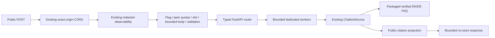

# Phase 3.3 — secure public retrieval API

2026-10-23 (Asia/Saigon), [CHATBOT-API-001](../../implementation/tasks/CHATBOT-API-001.md).
Baseline: clean local `main` at `d890fb0840e2196f301d60076c1b427cc1b687ff`.
Backend-only implementation and local acceptance; no push, deployment or Production enablement.
This dated continuation supersedes earlier statements that no FastAPI route exists in source.
The API defaults OFF. Cloudflare and Gemini remain disabled; Phase 3.2's live-provider blockers
are unchanged and do not prevent retrieval-only operation.

## Request and response

`POST /api/chatbot/query`, `Content-Type: application/json`, no query parameters:

```json
{ "question": "How do I register?" }
```

Only `question` is accepted. No user ID, language/locale, provider selector, token or history field.
The authoritative service detects EN/DE from the question; ambiguous/unsupported language returns
its existing bilingual language-choice message. Multi-question answers and uncertainty are unchanged.

```json
{
  "answer": "<existing curated answer, reproduced without factual edits>",
  "language": "en",
  "supported": true,
  "status": "answer",
  "sources": [
    {
      "entry_id": "website-register",
      "title": "BuddyWeb guide",
      "verification_status": "verified_code",
      "verified_on": "2026-10-22",
      "references": []
    }
  ],
  "mode": "local_retrieval"
}
```

This is a structural example; the bracketed answer is not new FAQ content. Pydantic DTOs and
OpenAPI are defined in [schema](../../../apps/api/app/schemas/chatbot.py) and
[router](../../../apps/api/app/api/chatbot.py). `language` is `en`, `de` or `und`.
`supported` means at least one verified citation, including a partly answerable multi-question
request; read the answer's existing uncertainty for unsupported parts. It is not a confidence score.

`sources` has at most three entries with the original stable ID, verification status and date.
Repository-only evidence is represented by a public guide label and ID, with no file path or
invented web link. Existing public source titles/URLs are retained when present, including on
code-verified entries. URLs must be HTTPS on `vgu.edu.vn` or its subdomains, port 443/default,
without credentials, query, fragment, whitespace or controls. Validation failure becomes a safe
server error; the backend never fetches these URLs. Official citations require a public reference.
The original eight corpus files, 17 verified bilingual FAQs and nine excluded summaries are unchanged.

| HTTP | `status`                           | Meaning                                                                        |
| ---- | ---------------------------------- | ------------------------------------------------------------------------------ |
| 200  | `answer`                           | Verified answer, possibly with uncertainty for an unanswered part              |
| 200  | `insufficient`                     | Valid question, insufficient verified knowledge; original EN/DE fallback       |
| 200  | `choose_language`                  | Existing bilingual request for English/German                                  |
| 200  | `restricted`                       | Existing public-only boundary message                                          |
| 400  | `invalid_request`                  | Malformed/duplicate-key JSON, invalid length header or disconnected body       |
| 405  | `method_not_allowed`               | Canonical endpoint accepts POST; `Allow: POST`                                 |
| 413  | `payload_too_large`                | Body exceeds byte limit, including streamed bodies                             |
| 415  | `unsupported_media_type`           | Non-JSON or compressed content                                                 |
| 422  | `invalid_request`                  | Invalid/missing/blank/long question, extra field or query parameter            |
| 429  | `rate_limited`                     | Client/global quota exhausted; `Retry-After` in seconds                        |
| 503  | `disabled` / `configuration_error` | API OFF or invalid local settings/attempt to enable AI                         |
| 503  | `overloaded`                       | Client-state capacity or concurrency full; `Retry-After: 1`                    |
| 503  | `unavailable`                      | Packaged knowledge unavailable, or router mounted without protection           |
| 504  | `timeout`                          | Body/retrieval response deadline; `Retry-After: 1`                             |
| 500  | `internal_error`                   | Unexpected retrieval/projection failure, including oversized serialized output |

Operational errors share the response shape: `supported: false`, no sources and a generic bilingual
message (a knowledge outage retains the service's localized fallback). They never echo validation
input, exception strings, paths, provider details or prompts. Responses include `Cache-Control:
no-store`, `Pragma: no-cache` and the existing server-generated `X-Request-ID`. Existing CORS exposes
`Retry-After`/`X-Request-ID` to allowed origins. Browser preflight remains in the existing outer CORS
middleware. Use the canonical URL; framework trailing-slash redirects are not answer responses.

## Architecture and authentication



[main](../../../apps/api/app/main.py) registers only the scoped middleware/router and shutdown
cleanup. [Runtime](../../../apps/api/app/core/chatbot.py) owns configuration, ephemeral counters,
slots and a dedicated executor. No new dependency, database migration or shared domain refactor.
The existing auth limiter was inspected: its Production contract requires shared TLS Redis and
does not bound local client-key cardinality. The chatbot instead reuses trusted peer normalization
and existing redacted logging, with a small explicitly bounded local limiter. Auth limits are unchanged.

Anonymous and authenticated visitors receive identical public answers. The endpoint does not invoke
`optional_auth`, load a user or inspect cookies. Missing, invalid, expired or valid cookies have no
effect on knowledge or quota identity. There is no auth-based quota upgrade. This avoids a private
database lookup for public information; it does not weaken authentication on any existing route.
No profile, Buddy, invitation or conversation is accessible. The POST is a stateless public read;
it sets no session cookie, changes no user state and needs no CSRF token. Existing exact-origin CORS
rules apply, but CORS is not an abuse-control boundary for non-browser clients.

The API and CLI call the same retrieval service. No prompt execution, dynamic SQL, user-selected
file, URL fetch, evaluation harness or provider call is added. Injection phrase handling is defense
in depth; the decisive boundary is verified-only retrieval without generation or private tools.

## Configuration and resource bounds

Environment is read once on the first chatbot request; restart the process to apply changes.
Boolean values must be exactly `true`/`false`. Invalid values fail closed with 503 and do not stop
unrelated routes. No credentials are read or required. `CHATBOT_AI_ENABLED=true` is deliberately
rejected, not a live-provider switch; a later task must explicitly implement and approve inference.

| Variable                     | Default | Accepted range / behavior                          |
| ---------------------------- | ------- | -------------------------------------------------- |
| `CHATBOT_API_ENABLED`        | `false` | Local opt-in only in this phase                    |
| `CHATBOT_AI_ENABLED`         | `false` | Only false supported                               |
| `CHATBOT_CLIENT_REQUESTS`    | 30      | 1–600 requests per peer/window                     |
| `CHATBOT_GLOBAL_REQUESTS`    | 300     | 1–5000 requests per process/window                 |
| `CHATBOT_WINDOW_SECONDS`     | 60      | 10–3600 seconds                                    |
| `CHATBOT_MAX_CLIENTS`        | 2048    | 1–10000 live client buckets                        |
| `CHATBOT_MAX_QUESTION_CHARS` | 500     | 1–500 Unicode characters                           |
| `CHATBOT_MAX_BODY_BYTES`     | 4096    | 1024–16384 actual received bytes                   |
| `CHATBOT_CONCURRENCY`        | 2       | 1–4 body-reading/worker admissions                 |
| `CHATBOT_DEADLINE_MS`        | 2000    | 50–5000 ms for body receipt and retrieval response |

Strict question validation reuses the existing contract, including normal EN/DE punctuation,
Unicode, newline/tab and rejection of other ASCII controls. Extra JSON fields and duplicate keys
are rejected before FastAPI validation, so untrusted field names cannot leak through error locations.
Both declared and streamed body sizes are checked; compressed payloads are not decompressed.
Maximum answer remains 1800 characters, at most three retrieved citations, existing context bound
6000 characters, and maximum serialized API response 16384 UTF-8 bytes. Loader bounds remain 200
entries, 20 files and 512 KiB/file. No external context or chat history is assembled.

Admission checks quotas before parsing/body reads. Invalid and concurrency-rejected attempts count
toward admitted client/global quotas; rejected quotas/capacity requests allocate no new live bucket.
Client fixed windows have TTL expiry; live buckets are never evicted to reset quotas. A full table
fails closed. Raw normalized IPs are immediately keyed with a random per-process BLAKE2 hash; only
16-byte digests/counts/monotonic expiry times are kept, removed on subsequent admission after expiry
or shutdown. No persistent history or cross-restart identifier. Global windows are process-local.

One slot covers body receipt then synchronous work. A separate executor cannot queue more work than
the slot count and does not occupy the shared auth/database worker pool. A timed-out/cancelled HTTP
request **retains its worker slot until the function actually completes**. Deadline expiry returns
504; it cannot interrupt Python retrieval, initialization, JSON parsing/serialization or forcibly kill
a thread. A permanently stuck worker would retain capacity until restart. CPU contention and server
transport buffering still exist; this is bounded application work, not complete denial-of-service
protection. Shutdown cancels queued work and clears counters; running Python workers must finish.

## Proxy, privacy and deployment limits

Client identity uses existing `client_identifier(Request)`: normalized ASGI transport peer, including
IPv6 canonicalization and IPv4-mapped IPv6. The code never directly trusts `X-Forwarded-For`,
`Forwarded` or `X-Real-IP`. Cookies/request IDs do not create new quota identities. Distinct IPv6
addresses remain distinct; NAT users share a bucket. Rotating addresses can bypass per-peer limits,
while the separate process-wide quota/concurrency bounds still apply.

The existing Docker command trusts proxy headers only from loopback (`127.0.0.1`). This phase does
not alter that command or establish the deployed ingress chain. Before later public enablement,
verify that the actual ingress strips/splices forwarding headers correctly and that Uvicorn trusts
only that ingress. Otherwise callers may share a proxy bucket, or a misconfigured trusted proxy may
accept spoofed identities. Do not use `--forwarded-allow-ips '*'` as a shortcut.

State is **not distributed**, resets on restart and is multiplied by workers/instances. Fixed-window
boundary bursts are possible; no daily quota or platform cost ceiling is claimed. This is a practical
zero-service fallback for the estimated small traffic, not validated multi-instance protection.
Existing Free-host cold starts/resource limits still apply. A separate rollout decision must accept
these limits and verify proxy behavior; Production remains unchanged and source-default OFF.

The existing structured operations logger emits request ID, method, route template, status and
duration. It captures rate/overload/failure HTTP status without questions, answers, raw IPs, cookies,
emails or exception text. Rejections before routing use its existing `<unmatched>` route label.
Uvicorn/platform access logs are separate and may include client IPs/query strings; local verification
disables Uvicorn access logs. Production log retention/redaction was not verified or changed.
No external analytics or persistent chat storage is introduced.

## Local commands and acceptance

From `apps/api` in PowerShell, reuse the existing environment. These flags affect only this shell:

```powershell
$env:CHATBOT_API_ENABLED = 'true'
$env:CHATBOT_AI_ENABLED = 'false'
.venv/Scripts/python.exe -m uvicorn app.main:app --host 127.0.0.1 --port 8000 --no-proxy-headers --no-access-log
```

From another PowerShell window:

```powershell
Invoke-RestMethod -Method Post -Uri http://127.0.0.1:8000/api/chatbot/query -ContentType 'application/json; charset=utf-8' -Body '{"question":"How do I register?"}'
Invoke-RestMethod -Method Post -Uri http://127.0.0.1:8000/api/chatbot/query -ContentType 'application/json; charset=utf-8' -Body '{"question":"Wie registriere ich mich?"}'
Invoke-RestMethod -Method Post -Uri http://127.0.0.1:8000/api/chatbot/query -ContentType 'application/json; charset=utf-8' -Body '{"question":"What is the weather on Mars?"}'
```

Expect 200 EN/DE curated answers and a 200 English `insufficient` fallback for the third request.
HTTP 429/503/504 are operational outcomes to handle, not knowledge misses. Stop the server with
Ctrl+C; unset the API flag or set `false` and restart to verify 503 `disabled`. No database/Redis/
provider credentials are needed for these routes. `/api/health/live` also needs no external service;
readiness and other application features retain their own dependency requirements.

Tests use synthetic signed cookies and a mocked persisted user. `/api/auth/me` first proves that
the fixture is authenticated; subsequent chatbot requests add no database calls. No Production
credentials are needed. Real loopback Uvicorn HTTP acceptance also checked these fixtures, EN/DE,
knowledge miss, 501-character/oversized-body failures, 429 plus retry header, flag-OFF and liveness.
Fourteen checks passed; socket connections were restricted to loopback, provider calls were blocked,
the only mock database read was `/auth/me`, and the server was stopped afterward.

Focused API tests: **68 PASS**. They cover all 17 FAQs in both languages, public citations, explicit
miss/language/injection/multi-question states, cookies, malformed/duplicate/deep JSON, types/fields,
body/question bounds, safe configuration and worker failures, no question logging/network/provider,
IPv4/IPv6/spoof headers, client/global quota/TTL/capacity, cancellation/deadline slots, CORS and shutdown.
The unchanged Phase 3.1/3.2 tests are included in the broader backend regression below.

```powershell
.venv/Scripts/python.exe -m pytest tests/test_chatbot_api.py -q --basetemp=.local/pytest-phase33-api
.venv/Scripts/python.exe -m pytest tests -q --ignore-glob=tests/*live.py --basetemp=.local/pytest-phase33-regression
.venv/Scripts/python.exe -m ruff check app tests
.venv/Scripts/python.exe -m ruff format --check app/api/chatbot.py app/core/chatbot.py app/schemas/chatbot.py app/main.py tests/test_chatbot_api.py tests/test_chatbot.py
.venv/Scripts/python.exe -m mypy app tests/test_chatbot_api.py tests/test_chatbot.py tests/test_chatbot_evaluation.py
.venv/Scripts/python.exe -m build --wheel --no-isolation --outdir dist/chatbot-phase33
```

Final non-live backend regression: **1717 PASS** (45.78 s); one existing AnyIO/Starlette
deprecated-alias warning, no final failures. Ruff app/tests, six changed-file format checks and
strict mypy on 127 files **PASS**. Wheel and extracted-wheel default-OFF/enabled-DE API **PASS**;
eight corpus files match source and `d890fb0` byte-for-byte. A variable-name collision in the
disposable package verification script was corrected before the final smoke passed.
Documentation/task/link/scope results are recorded in the
[validation record](../../implementation/validation.md). Runtime used: existing local Python 3.14;
no Python 3.12, Docker, live database/Redis or Production acceptance is claimed. Live-environment
test files are explicitly excluded. Windows sandbox socket/temp restrictions required unsandboxed
local socket execution and workspace-local temp directories. Initial failures were incorrect new
fixture assumptions (health path, citation types, historical uncertainty text, lexical language and
the available second FAQ); the authoritative retrieval/corpus was not changed to satisfy them.

## Phase 3.4 integration

The backend contract is ready for a separately assigned widget task; no frontend code is added.
Use the existing API base/origin conventions, send only `question`, and display answer text as text
(never raw HTML). Render structured public references as links with safe external-link attributes;
allow empty references for a code-confirmed guide citation. Handle `und` with the returned language
prompt; do not force the website locale onto the question. No auth refresh/user lookup is needed
for this public call; `credentials: omit` is sufficient where the existing client permits it.
Honor `Retry-After`, avoid automatic retry loops, and distinguish 200 uncertainty from server failure.
Keep API availability disabled in deployed environments until separately authorized rollout/proxy/
logging checks. AI integration remains subject to the existing provider eligibility and zero-cost
gates; this phase activates no service and adds zero operating cost or dependency.
