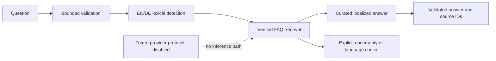

2026-11-04 [Chatbot UI alignment](UI_ALIGNMENT_2026-11-04.md): local-only redesign from current
Production6851725;104 focused tests/static/build/browser PASS. No push/deploy; older release gaps below
are historical and are not the current UI implementation status.

# Phase 3.1 — public knowledge and local retrieval

2026-11-03 newer continuation: [Phase3.5.2](PHASE_3_5_2.md) closes exact-candidate core browser
acceptance. Updated sixteen-gate matrix and precise owner acceptance checklist are authoritative;
Production remains NO-GO. Prior evidence below remains historical; no push/deploy authorized.

## Phase3.5.1 continuation —2026-11-03

[Current integration/gate report](PHASE_3_5_1.md) supersedes the old integration/Linux blocker below:
approvedc64 plus chatbot is isolated on codex/chatbot-phase35-integration; priora1aa is protected.
Actual Python3.12 Linux image and integration regressions are locally verified. **Production NO-GO**:
actual hosted proxy/logging and exact candidate CI/deployment remain unverified. Original records
below describe their completed historical snapshots; do not rerun them merely for documentation.

2026-11-01: [Phase 3.5 readiness](PHASE_3_5.md) completes independent local security/artifact/browser
validation with raw-access-log and UTF-8 CLI fixes. **RELEASE NO-GO**: this detached old main snapshot
must be integrated with the newer UI/security baseline; actual hosting proxy/logging/Linux gates
remain unverified.1851 backend/101 frontend PASS; source bytes unchanged, AI OFF, zero new cost.
See [executed commands](PHASE_3_5_COMMANDS.md) and [unexecuted Phase 3.6 runbook](PHASE_3_6_RUNBOOK.md).

2026-10-24 latest: [canonical source and intent retrieval](SINGLE_SOURCE_2026-10-24.md) replaces the
older two-entry-only runtime guide policy with byte-preserved systemPrompt.txt, atomic automatic
local reload and qualified owner/conflicted passage citations. 17 verified FAQs and all nine existing
JSON files remain unchanged. EN/DE intent variants, safe source updates and real browser flow pass;
German quotes retain explicitly untranslated English. Start with the [owner guide](OWNER_GUIDE.md).
Local verified only; flags/AI default OFF, no push/deploy. Earlier records remain historical.

2026-10-24 current refinement: [historical references and transitions](REFINEMENT_2026-10-24.md)
restores two owner-authorized low-risk guide references, separately qualified from 17 verified FAQs
and nine unchanged exclusions. Public DTO adds historical status; lazy panel gains enter/exit,
reduced motion and mobile scroll/focus refinement. Local verified only; flags default OFF, AI OFF.
Earlier corpus/contract statements below describe their completed snapshots.

2026-10-24 newer continuation: [Phase 3.4 frontend and local API acceptance](PHASE_3_4.md)
adds the default-OFF floating public/USER widget. It uses the unchanged Phase 3.3 contract, EN/DE
and safe sources without inference, persistent history or new knowledge. Older no-frontend
statements describe earlier snapshots; no deployment is implied.

2026-10-23 newer continuation: [Phase 3.3 API contract and local acceptance](PHASE_3_3.md)
adds the secure retrieval-only FastAPI route in source, default OFF, with bounded local resources.
The older no-route statements below describe Phase 3.1/3.2 only. Corpus/AI/deployment boundaries
remain unchanged; the backend contract is ready for a separately assigned Phase 3.4 frontend task.

2026-10-23 continuation: [Phase 3.2 results and current behavior](PHASE_3_2.md) supersede the
single-answer/normalization details of this Phase 3.1 snapshot. The corpus remains unchanged;
providers and public routes remain disabled. Live AI benchmarking is blocked, offline work complete.

Implemented locally on 2026-10-22 for [CHATBOT-KB-001](../../implementation/tasks/CHATBOT-KB-001.md).
Source inspected at `f88c18d`; acceptance results live in the task and
[validation record](../../implementation/validation.md). No release is implied.

## Run the prototype

From `apps/api`, using the existing environment (PowerShell):

```powershell
'How do I register?' | .venv/Scripts/python.exe -m app.services.chatbot
'Wie funktioniert Buddy Matching?' | .venv/Scripts/python.exe -m app.services.chatbot
.venv/Scripts/python.exe -m pytest tests/test_chatbot.py -q
```

One question goes through stdin; one JSON answer with language, outcome, text and citations
comes back. Invalid input exits 2 with a generic diagnostic. No questions are stored or logged.
This CLI is functional without credentials, a database, Redis or Internet access. It is not
connected to the existing assistant placeholder, FastAPI routers or a public website widget.

## Architecture and decisions



The service lives in [app/services/chatbot](../../../apps/api/app/services/chatbot/service.py),
following the backend domain-service convention. Pydantic, pathlib, immutable contracts and
the current packaging/test tools are reused. Existing PostgreSQL/SQLAlchemy supports SQL
queries, but no configured full-text index, BM25 package or chatbot retrieval layer was found
in the inspected backend dependencies and routes. For 26 small records, an in-memory keyword
index is simpler than SQL full-text search or another dependency. No migration or embeddings.

Responsibilities are split into models, loader, language detection, retrieval, answer selection,
provider protocol and CLI. `AnswerProvider`, `ProviderRequest` and `ProviderAnswer` are the future
vendor seam. Even an injected provider is never called in this phase. `DisabledProvider` raises
a generic unavailable signal if invoked independently. There is no environment flag that turns
inference on. Missing or corrupt knowledge fails safely; unavailable AI cannot block local FAQs.

Later authenticated tools must be a separate capability-checked adapter at the service boundary,
receiving the authenticated principal through existing API dependencies. Reserve Events,
Matching, Profiles and Invitations as future capabilities; do not pass database sessions, cookies,
user IDs or tool clients into this public retriever. No such tool is implemented or registered.

## Knowledge and FAQ coverage

[Packaged JSON](../../../apps/api/app/services/chatbot/knowledge.py) contains 17 answerable
EN/DE FAQs (two official-source facts, fifteen source-code-confirmed guides/referrals), plus nine
excluded historical summaries. Categories are vgu, buddy-program, student-life, campus-services,
accommodation, buddyweb-guide and faq; transportation currently has historical material only.
Files are organized by category; `historical.json` preserves uncertainties in a quarantine.

Each entry has a stable ID, category, status, actual verification date or null, titled sources,
EN/DE question aliases, curated answer and optional keywords. `verified_code` proves implemented
behavior or a published website link, not a university policy or current Production availability.
`verified_official` means the cited official content was inspected on the recorded date; it is
not a promise that the service never changes. Public responses include evidence dates/status.
English/German translations are curated here, not official university translations.

FAQs cover VGU identity; Buddy community/participation/help; campus service links; library
printing; dormitory/International Office/sports referrals; registration/email verification;
matching; invitations; selected profile details; Events; Buddy chat. Participation refers users
to the program team because admissions/recruitment rules are not verified. Event guidance
explicitly depends on launch flags and does not claim to fetch a live list. Assistant/Campus
dashboard placeholders are not advertised as functional services.

The [historical-source audit](SOURCE_AUDIT.md) identifies duplicates, conflicting meal/passport
claims, missing links, administrative location differences, sensitive advice and old prices.
Important gaps: current visa/arrival rules, staff contacts/office hours, meal services, transport,
housing fees, health/insurance, sports schedules and institutional recruitment procedure.
Do not promote these entries until the claim is checked with its responsible official source.

## Retrieval and language behavior

The retriever first filters out unverified/conflicting/outdated records. Unicode NFKC/casefold
tokenization handles punctuation and German umlauts. A small explicit German inflection map
handles `erstelle/erstellen`, `registriere/registrieren` and `finde/finden`.

Exact curated question matches take precedence; collisions abstain. Otherwise, remove common
EN/DE stop words and compare question aliases. Identical meaningful term sets match. Other
candidates need at least two shared terms, 70% query coverage and 50% alias coverage. Score is
0.7 × query coverage + 0.3 × alias coverage. A top-two gap below 0.12 abstains. Return at most
three hits; the service emits only the best answer and its source citation. Answer text is not
searched, preventing incidental prose from becoming an intent match. Keywords are editorial
metadata, not sufficient to authorize an answer. No generative synthesis or BM25 dependency.

Language comes from lexical markers in the question, never the UI locale. A dominant EN/DE
signal allows common UI loanwords; balanced mixed language, short neutral names and unsupported
input get an explicit bilingual language choice. This intentionally favors abstention and has
limited paraphrase/compound-word coverage. Future evaluations should expand aliases using real,
redacted questions rather than lowering relevance thresholds indiscriminately.

## Safety and public-access boundary

- Input: strict string, nonblank, 500 characters, no control codes except newline/tab.
- Output: 1,800 characters; maximum three citations. Context helper: at most three verified
  snippets / 6,000 characters. Local answer generation uses one curated FAQ, no provider context.
- Corpus: at most 200 entries, 20 JSON files, 512,000 bytes per file; schema and duplicate-ID
  validation. The original prompt is never read by the runtime.
- No network, database, private-data capability, user-selected file path, history, prompt log,
  external inference or secret lookup. No HTTP attack surface is added.
- Injection/private-access phrase checks are defense in depth. The security boundary is the
  absence of execution, generation and tools; the heuristic is not a general injection detector.
- [Compact behavior instructions](../../../apps/api/app/services/chatbot/instructions.md) stay
  separate from data. They document a future provider contract and are not exposed in answers.

Before any public endpoint, add explicit route registration only after approval, transport body
limits before parsing, concurrency and request deadlines, trusted-peer limits through existing
`app/core/rate_limits.py`, a shared daily quota and fail-closed storage behavior. Existing middleware
only covers selected route sets; a new route would not inherit anonymous protection automatically.
Reuse safe 429/503/no-store responses and minimal aggregate metrics. Do not log raw questions,
authorization headers or source contents. Provider calls additionally require timeout/cancellation,
bounded token counts, no automatic retry on quota exhaustion, an account-level free-only policy,
model allowlist and an atomic daily reserve before any call. These are future release gates,
not claims of implemented public protection. Local synchronous retrieval has bounded work and
no remote wait; the CLI acceptance test also has a process timeout.

## Roadmap

| Phase | Exact boundary / exit evidence                                                                                                                                                                                        |
| ----- | --------------------------------------------------------------------------------------------------------------------------------------------------------------------------------------------------------------------- |
| 3.1   | Structured verified knowledge, bilingual FAQ, local retrieval, tests, source/provider research                                                                                                                        |
| 3.2   | Resolve age/EU/data-processing and license suitability; verify actual free account/model eligibility without billing; prepare redacted EN/DE benchmark and quota/error cases; inference remains separately authorized |
| 3.3   | Approved vendor adapter plus backend route with shared public abuse/quota/deadline safeguards; review separate authenticated tool contracts                                                                           |
| 3.4   | Responsive accessible EN/DE widget for anonymous and authenticated users; source/uncertainty display and keyboard/screen-reader tests                                                                                 |
| 3.5   | Consider retrieval enhancement only after measured FAQ misses justify it; retain zero-cost fallback                                                                                                                   |
| 3.6   | Privacy/security/capacity/rollback acceptance and explicit Production release request                                                                                                                                 |

See [provider assessment](PROVIDERS.md) for official links and unresolved compliance/cost gates.
No paid resource was enabled or used. Local work has no additional operating service cost.

## Updating knowledge

Edit the relevant category JSON, preserve IDs, cite a public official source or a specific source
file, and record a verification date only after inspecting it. Retain uncertain claims with null
dates and an excluded status; supersede historical claims with new reviewed entries. Add positive
EN/DE aliases plus nearby negative questions, run the focused suite, static checks and package
smoke, then update the task/control-plane records. Avoid private contacts or account-specific data.
The project-wide historical audit checkpoint is not advanced by this focused feature review.
