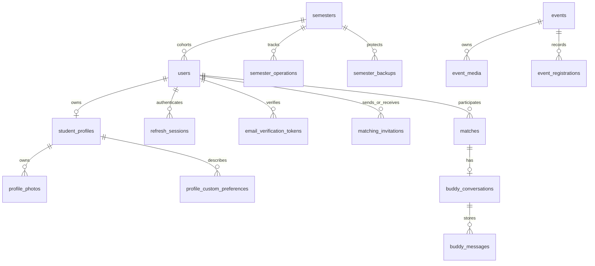

# Database, migrations and integrity

PostgreSQL stores private application tables in `app_private`, accessed through SQLAlchemy.
An Alembic migration is a versioned schema change; having its file in Git does not establish
that a deployed database ran it. Local development uses PostgreSQL 17; hosted service versions
must be established from environment evidence rather than inferred from Compose.

## Entity relationships

This is a conceptual relationship diagram, not a complete DDL export. Participant relationships
have two user/profile foreign keys. Catalog joins and audit/outbox references are omitted for
readability; inspect the [models](../../../apps/api/app/models/__init__.py) for exact names.

## Important table families and rules

| Family                                                   | Responsibilities / constraints                                                                                          |
| -------------------------------------------------------- | ----------------------------------------------------------------------------------------------------------------------- |
| `users`, `refresh_sessions`, `email_verification_tokens` | Custom identity, hashed credentials/token state, role, current email verification and session rotation                  |
| `student_profiles`, `profile_photos`                     | User-owned profile/version; media processing/ownership; private object lifecycle                                        |
| `interests`, `activities`, `languages` and profile joins | Normalized catalogs, active selections and custom preferences                                                           |
| `matching_invitations`                                   | Sender/recipient, state/expiry, effective pending-pair uniqueness, bounded inert text                                   |
| `matches`                                                | Distinct participants/profiles, score 0..100, generated canonical low/high pair, partial unique ACTIVE pair             |
| `buddy_conversations`, `buddy_messages`                  | Match conversation identity, message ownership, retry identity/read/expiry state                                        |
| `events`, `event_media`, `event_registrations`           | Lifecycle/version, owned ready cover, per-event/user registration uniqueness; model presence does not prove UI delivery |
| `semesters`, `semester_operations`, `semester_backups`   | Current cohort, monotonic new-user marker, attributable guarded recovery and verified manifests                         |
| `audit_logs`, `transactional_outbox`                     | Attributable operations and durable email intent; distinct from realtime transport                                      |

[Match model](../../../apps/api/app/models/buddy_match.py) computes unordered-pair identity
with `LEAST`/`GREATEST`. Thus A→B and B→A cannot create separate ACTIVE relationships.
[Chat model](../../../apps/api/app/models/buddy_chat.py) prevents duplicate retry effects.
[Event model](../../../apps/api/app/models/event.py) binds cover ownership through composite
relationships; knowing an image ID does not grant another Event ownership.

Foreign keys prevent dangling relationships; check constraints reject impossible row states;
unique indexes reject duplicates even when two requests race. Service locks and rechecks are
still needed for transitions spanning multiple rows. SQL constraints complement API validation.

## Migration evolution

All paths are enumerated in [the inventory](../EVIDENCE_INDEX.md).

| Revisions | Change                                                                                |
| --------- | ------------------------------------------------------------------------------------- |
| 0001–0003 | Private schema/runtime boundary, users and refresh-session persistence                |
| 0004–0006 | Audit logs, private Storage buckets, profile/catalog persistence                      |
| 0007      | Event, registration and media tables                                                  |
| 0008–0010 | Verification tokens, transactional outbox and narrowly scoped Edge delivery functions |
| 0011–0013 | Custom preferences, invitations and ACTIVE Match persistence                          |
| 0014–0016 | Conversations/messages, send idempotency and cleanup                                  |
| 0017–0018 | Semester boundary metadata and backup verification                                    |
| 0019–0021 | Guarded reset/restore execution and narrow runtime restore permissions                |
| 0022      | Default legacy Event visibility storage to PUBLIC without updating existing rows      |

Audit baseline has one linear revision chain ending at
[0022](../../../apps/api/alembic/versions/0022_public_event_visibility_default.py).
The 0022 downgrade restores the former default; it is not a disaster-recovery procedure.
Production 0021 was previously verified; newer Production 0022 observation remains missing.
Do not “repair” history by editing `alembic_version` or assuming a health response proves revision.

## Data lifecycle and recovery

Account deletion uses explicit FK policies, not an assumed universal cascade. A dated,
separately authorized [deletion record](../../operations/account-delete-001-production-2026-10-17.md)
confirms owned profile/Buddy/session data cascaded, the other participant survived, private image
cleanup was separate, and two sent outbox rows remained with nullable recipient references.
This audit copies no target account identifiers or payloads.

Messages expire after 90 days; maintenance removes them in bounded work. Event deletion is a
managed lifecycle with soft-deletion/media handling, distinct from hard deleting a USER.
Semester recovery protects both SQL data and avatars; restoring only database rows can leave
broken object references. Full encrypted off-site recovery remains an open hardening task.
